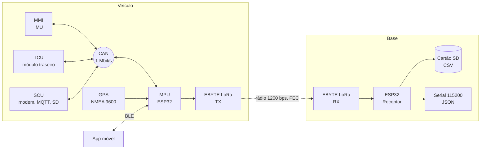
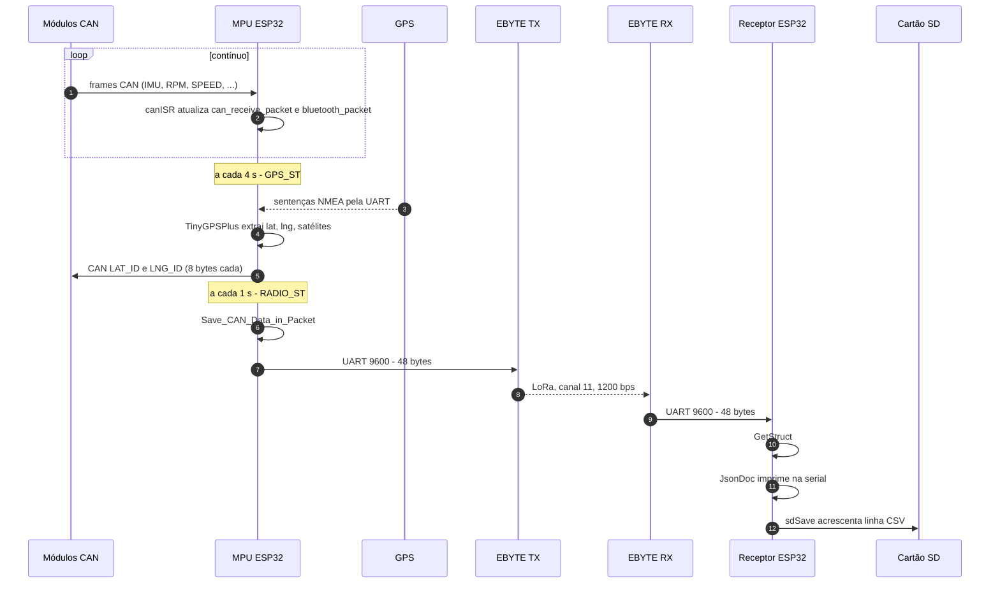
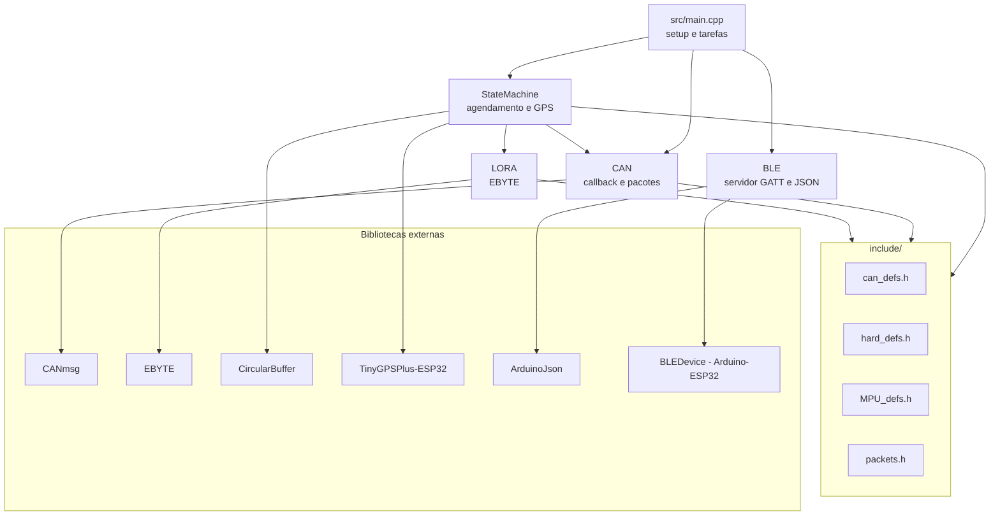
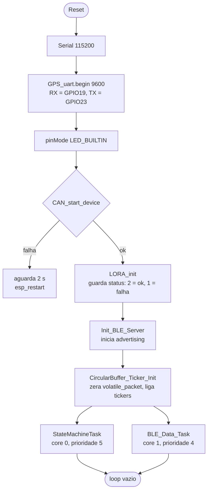
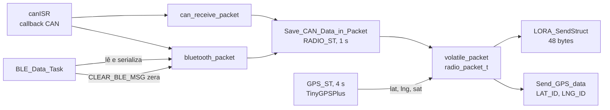
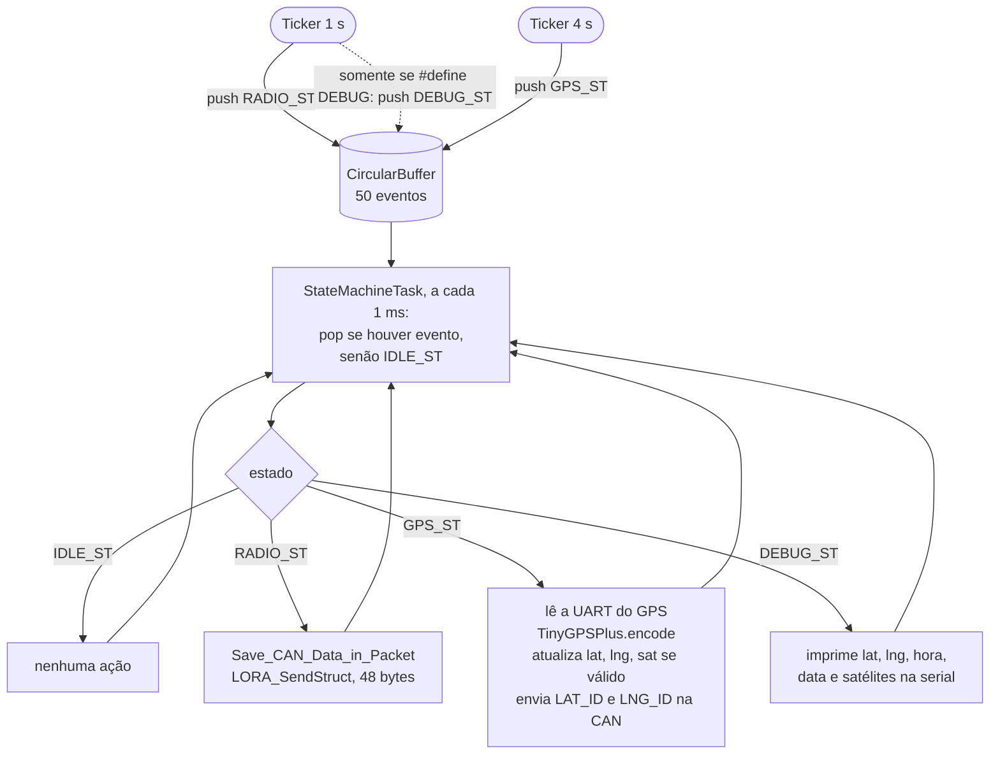
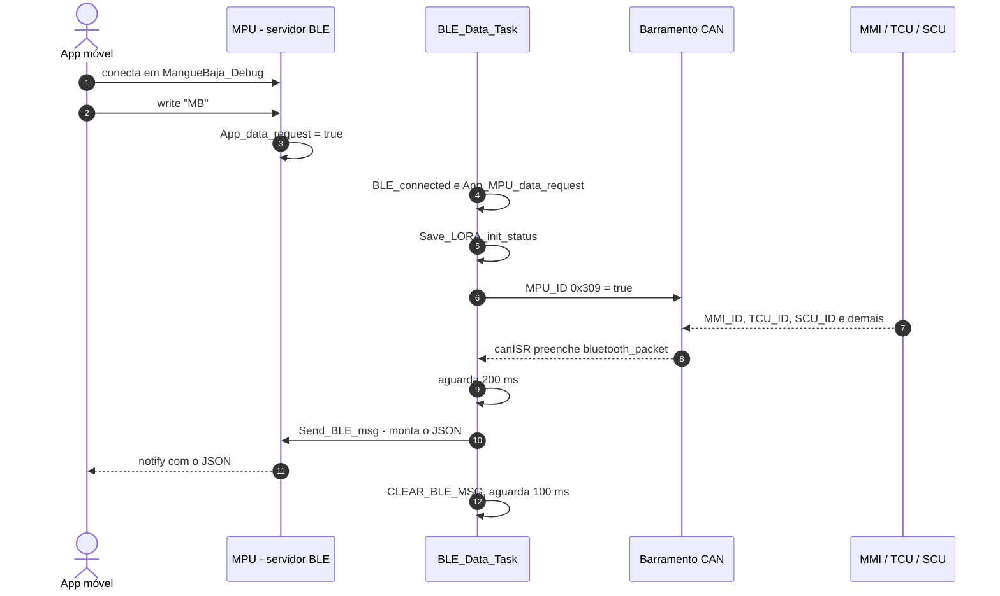
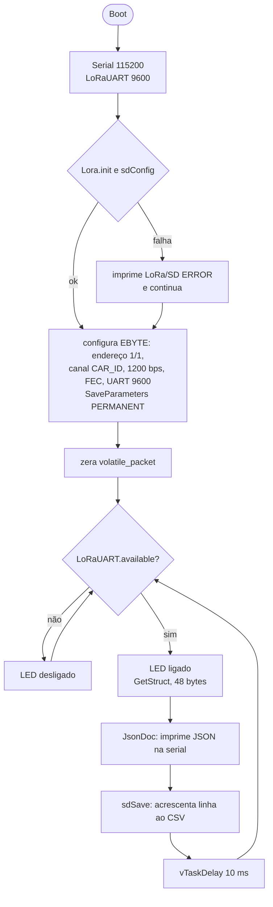
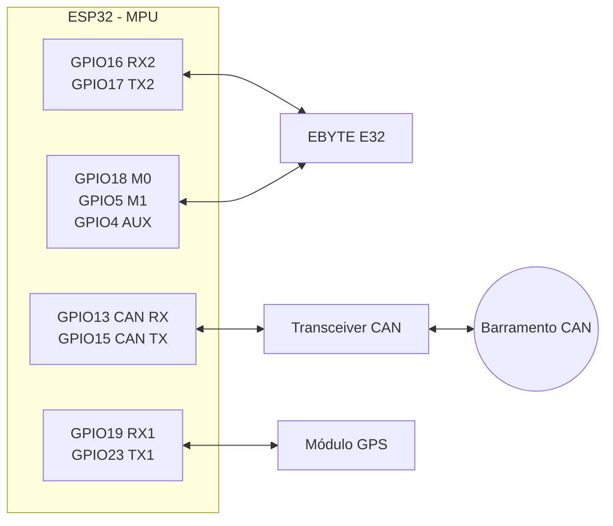

# MangueBaja MPU-25 — Telemetria Veicular via CAN, GPS, LoRa e BLE


Sistema de telemetria do veículo Baja SAE da equipe **Mangue Baja (UFPE)**. Um **Módulo de Processamento (MPU)** embarcado, baseado em ESP32, consolida os dados publicados pelos demais módulos na rede **CAN**, adiciona a posição **GPS** e transmite um pacote binário de 48 bytes por **rádio LoRa (EBYTE)** a 1 Hz. Um **receptor** em terra decodifica o pacote, emite JSON pela serial e grava um CSV em cartão SD. O MPU também expõe um servidor **BLE** de depuração, consultável por um app móvel.

---

## Sumário

1. [Visão geral](#1-visão-geral)
2. [Arquitetura do sistema](#2-arquitetura-do-sistema)
3. [Arquitetura de software](#3-arquitetura-de-software)
4. [Fluxo de dados e estado compartilhado](#4-fluxo-de-dados-e-estado-compartilhado)
5. [Agendamento e máquina de estados](#5-agendamento-e-máquina-de-estados)
6. [Barramento CAN](#6-barramento-can)
7. [Rádio LoRa](#7-rádio-lora)
8. [GPS](#8-gps)
9. [Depuração via BLE](#9-depuração-via-ble)
10. [Receptor](#10-receptor)
11. [Hardware e pinagem](#11-hardware-e-pinagem)
12. [Estrutura do repositório e dependências](#12-estrutura-do-repositório-e-dependências)
13. [Compilação e gravação](#13-compilação-e-gravação)
14. [Solução de problemas](#14-solução-de-problemas)
15. [Limitações conhecidas e melhorias sugeridas](#15-limitações-conhecidas-e-melhorias-sugeridas)
16. [Equipe](#16-equipe)

---

## 1. Visão geral

| Bloco | Hardware | Responsabilidade |
|---|---|---|
| **MPU** (transmissor) | ESP32 | Escuta a CAN, lê o GPS, monta e envia o pacote LoRa a cada 1 s, atende requisições de depuração via BLE. |
| **Módulos CAN** (MMI, TCU, SCU, ...) | Outros microcontroladores | Publicam sensores (IMU, RPM, velocidade, temperaturas, tensão, flags) e status de subsistemas. |
| **GPS** | Módulo NMEA, 9600 baud | Fornece latitude, longitude e número de satélites. |
| **Rádio** | EBYTE (família E32) via UART | Enlace LoRa entre o veículo e a base. |
| **Receptor** | ESP32 + EBYTE + módulo SD | Recebe o pacote, imprime JSON na serial e grava CSV. |
| **App de depuração** | Celular (BLE) | Envia `"MB"` e recebe o status dos subsistemas em JSON. |

**Resumo funcional**

- **CAN a 1 Mbit/s**, IDs de 11 bits, decodificação em *callback* (`canISR`).
- **Agendamento orientado a eventos**: dois `Ticker`s (1 s e 4 s) enfileiram estados em um `CircularBuffer`, consumido por uma tarefa FreeRTOS dedicada.
- **Pacote LoRa de 48 bytes** (`radio_packet_t`), enviado a 1 Hz com taxa de ar de 1200 bps e FEC habilitado.
- **GPS lido a cada 4 s**, com publicação de latitude/longitude de volta na CAN.
- **BLE** com nome `MangueBaja_Debug`, protocolo de requisição e resposta em JSON.

---

## 2. Arquitetura do sistema



### 2.1 Ciclo de telemetria de ponta a ponta



---

## 3. Arquitetura de software

### 3.1 Módulos



| Módulo | Arquivos | Responsabilidade |
|---|---|---|
| **main** | `src/main.cpp` | Inicializa periféricos e cria as tarefas FreeRTOS. |
| **StateMachine** | `StateMachine.cpp/.h` | Tickers, `CircularBuffer` de estados, despacho de `RADIO_ST` / `GPS_ST` / `DEBUG_ST`, leitura do GPS. |
| **CAN** | `CAN.cpp/.h` | Inicialização da CAN, callback `canISR`, montagem do pacote de rádio, envio de GPS e de requisição do MPU. |
| **LORA** | `LORA.cpp/.h` | Configuração do módulo EBYTE e envio de structs. |
| **BLE** | `BLE.cpp/.h` | Servidor GATT, protocolo `"MB"` e serialização do JSON de depuração. |

### 3.2 Tarefas e contextos de execução

| Contexto | Core | Prioridade | Stack | Período | Função |
|---|---|---|---|---|---|
| `StateMachineTask` | 0 | 5 | 4096 B | `vTaskDelay(1)` | Consome o `CircularBuffer` e executa o estado. |
| `BLE_Data_Task` | 1 | 4 | 4096 B | `vTaskDelay(1)`; 200 ms + 100 ms durante uma requisição | Atende requisições BLE. |
| Callback de `Ticker` (contexto do `esp_timer`) | — | — | — | 1 s e 4 s | Produz eventos `RADIO_ST` e `GPS_ST`. |
| Callback da CAN `canISR` | — | — | — | a cada frame | Atualiza o estado compartilhado e alterna o LED. |
| `loop()` | — | — | — | — | Vazio; todo o trabalho está nas tarefas. |

### 3.3 Sequência de inicialização



> A falha de inicialização da CAN reinicia o ESP32 indefinidamente (ciclo de *boot* a cada ~2 s).

---

## 4. Fluxo de dados e estado compartilhado

O MPU mantém três estruturas globais. Entender quem escreve e quem lê cada uma é essencial para depurar o sistema.

| Estrutura | Tipo | Escrita por | Leitura por |
|---|---|---|---|
| `can_receive_packet` | `radio_packet_t` | `canISR` (IMU, RPM, flags, tensão) | `Save_CAN_Data_in_Packet` |
| `bluetooth_packet` | `bluetooth` | `canISR` (status e vários sensores), `Save_LORA_init_status`, `CLEAR_BLE_MSG` | `Save_CAN_Data_in_Packet` **e** `Send_BLE_msg` |
| `volatile_packet` | `radio_packet_t` | `Save_CAN_Data_in_Packet` (campos CAN), `get_GPS_data` (lat, lng, sat) | `LORA_SendStruct`, `Send_GPS_data` |



### 4.1 Origem de cada campo de `radio_packet_t`

| Campo | Origem | Observação |
|---|---|---|
| `imu_acc` | `IMU_ACC_ID` (0x200) | 3 × `int16`, bruto |
| `imu_dps` | `IMU_DPS_ID` (0x201) | 3 × `int16`, bruto |
| `rpm` | `RPM_ID` (0x304) | `uint16` |
| `speed` | `SPEED_ID` (0x300) → `bluetooth_packet.speed_pulse_counter` | **Apenas 1 byte** é copiado, apesar de o campo ter 16 bits |
| `temperature` | `TEMPERATURE_ID` (0x400) → `bluetooth_packet.termistor` | 1 byte |
| `flags` | `FLAGS_ID` (0x101) | 1 byte (ver 6.4) |
| `SOC` | `SOC_ID` (0x302) → `bluetooth_packet.measure_volt` | O byte do SOC é guardado no campo chamado `measure_volt` |
| `cvt` | `CVT_ID` (0x401) → `bluetooth_packet.cvt_temperature` | 1 byte |
| `volt` | `VOLTAGE_ID` (0x502) | `float`, 4 bytes |
| `latitude`, `longitude`, `sat` | GPS (`TinyGPSPlus`) | Não vêm da CAN |
| `timestamp` | `millis()` no instante do `RADIO_ST` | ms desde o boot do MPU |

> As unidades físicas (°C, km/h, V, etc.) não estão definidas no código do MPU; elas são determinadas pelos módulos que publicam na CAN.

---

## 5. Agendamento e máquina de estados

O MPU não usa uma máquina de estados "clássica" com transições entre estados. Ele usa um **despachante orientado a eventos**: os `Ticker`s empurram *tokens* de estado para um `CircularBuffer<state_t, 50>` e a `StateMachineTask` consome um token por iteração (~1 ms). Sem tokens, o estado efetivo é `IDLE_ST`.



| Estado (`state_t`) | Disparo | Ação |
|---|---|---|
| `IDLE_ST` | Buffer vazio | Nenhuma. |
| `RADIO_ST` | Ticker de 1 s | Copia os dados da CAN para `volatile_packet`, carimba `timestamp` e envia por LoRa. |
| `GPS_ST` | Ticker de 4 s | Drena a UART do GPS; se houver posição válida, atualiza `volatile_packet`. Em seguida **sempre** publica latitude e longitude na CAN. |
| `DEBUG_ST` | Ticker de 1 s, só com `#define DEBUG` em `StateMachine.cpp` | Imprime diagnóstico do GPS na serial. |

> Quando as duas tarefas periódicas coincidem (a cada 4 s) os dois tokens entram na fila e são executados em sequência, um por iteração.

---

## 6. Barramento CAN

### 6.1 Configuração

| Parâmetro | Valor |
|---|---|
| Biblioteca | `CANmsg` (`CANmsg txMsg(CAN_RX_id, CAN_TX_id, CAN_BPS_1000K)`) |
| Taxa | 1 Mbit/s |
| Pinos | RX = GPIO13, TX = GPIO15 (requer transceiver CAN externo) |
| Identificadores | 11 bits (padrão); todos os IDs do projeto são ≤ 0x7FF |
| Dados | Copiados com `memcpy` em endianness nativa (little-endian no ESP32) |
| Recepção | Callback `canISR(CAN_FRAME*)`, que também alterna o `LED_BUILTIN` a cada frame |

### 6.2 Tabela de IDs (`include/can_defs.h`)

Na arbitragem CAN, IDs menores têm maior prioridade.

| ID | Nome | Tamanho nominal | Tratamento no MPU |
|---|---|---|---|
| `0x001` | `SYNC_ID` | — | Ignorado |
| `0x100` | `THROTTLE_ID` | 1 B (`0x00` MID, `0x01` RUN, `0x02` CHOKE) | Ignorado |
| `0x101` | `FLAGS_ID` | 1 B | `can_receive_packet.flags` → `flags` |
| `0x200` | `IMU_ACC_ID` | 6 B (3 × `int16`) | `imu_acc` |
| `0x201` | `IMU_DPS_ID` | 6 B (3 × `int16`) | `imu_dps` |
| `0x205` | `ANGLE_ID` | 4 B | Ignorado |
| `0x300` | `SPEED_ID` | 2 B (nominal) | **Copia 1 byte** → `speed_pulse_counter` → `speed` |
| `0x302` | `SOC_ID` | 1 B | → `measure_volt` → `SOC` |
| `0x304` | `RPM_ID` | 2 B | `rpm` |
| `0x305` | `SOT_ID` | 1 B | Ignorado |
| `0x306` | `MMI_ID` | 1 B | → `accel_begin` (status do acelerômetro) |
| `0x307` | `TCU_ID` | 1 B | → `servo_state` |
| `0x308` | `SCU_ID` | 1 B (bitfield) | Decodificado em 4 campos (ver 6.3) |
| `0x309` | `MPU_ID` | 1 B | **Transmitido pelo MPU**: requisição de status (`true`) |
| `0x400` | `TEMPERATURE_ID` | 1 B | → `termistor` → `temperature` |
| `0x401` | `CVT_ID` | 1 B | → `cvt_temperature` → `cvt` |
| `0x500` | `FUEL_ID` | 2 B | Ignorado (campo `fuel_level` está comentado) |
| `0x502` | `VOLTAGE_ID` | 4 B (`float`) | `volt` |
| `0x505` | `CURRENT_ID` | 4 B | Ignorado |
| `0x600` | `LAT_ID` | 8 B (`double`) | **Transmitido pelo MPU** após `GPS_ST` |
| `0x700` | `LNG_ID` | 8 B (`double`) | **Transmitido pelo MPU** após `GPS_ST` |

### 6.3 Decodificação do `SCU_ID` (0x308)

Um byte com quatro campos de 2 bits, decodificados em `canISR`:

| Bits | Campo (`bluetooth`) | JSON BLE |
|---|---|---|
| 1:0 | `internet_modem` | `SCU.INTERNET_MODEM` |
| 3:2 | `mqtt_client_connection` | `SCU.MQTT_CONNECTION` |
| 5:4 | `sd_start` | `SCU.SD_START` |
| 7:6 | `check_sd` | `SCU.SD_STATUS` |

O MPU usa para o rádio a convenção `0` = sem dado, `1` = falha (`FAIL_RESPONSE`), `2` = sucesso (`SUCESS_RESPONSE`). Os campos do SCU provavelmente seguem a mesma convenção; confirme no firmware do SCU.

### 6.4 Byte de flags

Os dois comentários do projeto descrevem o byte de forma diferente nos bits altos. **Os bits 2, 1 e 0 concordam**; os demais precisam ser unificados (ver seção 15).

| Bit | `can_defs.h` | `packets.h` |
|---|---|---|
| 7 | `LOW_BATTERY` | `BOX` |
| 6 | `DANGER_CVT` | `BUFFER FULL` |
| 5 | `DANGER_MOTOR` | `NC` |
| 4 | `LOW_FUEL_LEVEL` | `NC` |
| 3 | `MQTT_ON` | `FUEL_LEVEL` |
| 2 | `SERVO_ERROR` | `SERVO_ERROR` |
| 1 | `CHOKE` | `CHK` |
| 0 | `RUN` | `RUN` |

### 6.5 Estado do servo (`TCU_ID`)

| `servo_state` | Significado no JSON BLE |
|---|---|
| `4` | `CHOKE` |
| `3` | `MID` |
| `2` | `RUN` |
| outro | `ERRO` |

> Estes códigos diferem das constantes `THROTTLE_MID`/`RUN`/`CHOKE` (`0x00`/`0x01`/`0x02`) de `can_defs.h`, que pertencem ao `THROTTLE_ID`, um sinal distinto e ignorado pelo MPU.

---

## 7. Rádio LoRa

### 7.1 Parâmetros do módulo EBYTE

Aplicados na inicialização, no transmissor (`LORA_init`) e no receptor (`setup`), com valores idênticos:

| Parâmetro | Valor | Observação |
|---|---|---|
| Endereço | `H = 1`, `L = 1` | Iguais nas duas pontas |
| Canal | `CAR_ID` = `MB_ID` = **11** | Em módulos E32-433T, frequência = 410 + canal MHz (confirme no datasheet do seu módulo) |
| Taxa de ar | 1200 bps (`ADR_1200`) | Menor taxa, maior alcance |
| Potência | `OPT_TP30` (`0b00`) | Potência máxima do módulo (30 dBm nas versões 30 dBm) |
| UART | 9600 baud, 8N1 | `UDR_9600` |
| FEC | Habilitado | Aumenta robustez e tempo no ar |
| Modo | Normal (transparente) | `EBYTE_MODE_NORMAL` no TX, `MODE_NORMAL` no RX |
| Persistência | `SaveParameters(PERMANENT)` | Gravado na memória do módulo **a cada boot** |

Os valores de endereço, canal, taxa de ar, FEC e UART **devem coincidir** em transmissor e receptor.

### 7.2 Layout do pacote (`radio_packet_t`, 48 bytes)

Struct sem `packed`. Offsets calculados para ESP32 (Xtensa 32 bits); transmissor e receptor precisam compilar a mesma definição.

| Offset | Campo | Tipo | Tamanho |
|---|---|---|---|
| 0 | `imu_acc.acc_x` | `int16_t` | 2 |
| 2 | `imu_acc.acc_y` | `int16_t` | 2 |
| 4 | `imu_acc.acc_z` | `int16_t` | 2 |
| 6 | `imu_dps.dps_x` | `int16_t` | 2 |
| 8 | `imu_dps.dps_y` | `int16_t` | 2 |
| 10 | `imu_dps.dps_z` | `int16_t` | 2 |
| 12 | `rpm` | `uint16_t` | 2 |
| 14 | `speed` | `uint16_t` | 2 |
| 16 | `temperature` | `uint8_t` | 1 |
| 17 | `flags` | `uint8_t` | 1 |
| 18 | `SOC` | `uint8_t` | 1 |
| 19 | `cvt` | `uint8_t` | 1 |
| 20 | `volt` | `float` | 4 |
| 24 | `latitude` | `double` | 8 |
| 32 | `longitude` | `double` | 8 |
| 40 | `timestamp` | `uint32_t` | 4 |
| 44 | `sat` | `uint8_t` | 1 |
| 45 | *(padding)* | — | 3 |

> O payload **não tem cabeçalho de sincronismo, versão nem CRC**: o receptor lê `sizeof(radio_packet_t)` bytes assim que há dados na UART.

### 7.3 Orçamento de tempo no ar

| Item | Valor |
|---|---|
| Payload | 48 B = 384 bits |
| Tempo mínimo a 1200 bps | ≈ 0,32 s (sem contar preâmbulo, enquadramento do módulo e FEC) |
| Período de envio | 1 s |

O enlace ocupa pelo menos um terço do período de 1 Hz; FEC e overhead reduzem a folga. Se for necessário aumentar a taxa de envio, será preciso aumentar a taxa de ar (ex.: 2400 ou 4800 bps), com perda de alcance.

---

## 8. GPS

| Item | Valor |
|---|---|
| Biblioteca | `TinyGPSPlus-ESP32` |
| UART | `Serial1`, 9600 baud, 8N1 |
| Pinos efetivos do ESP32 | RX = **GPIO19** (liga no TX do GPS), TX = **GPIO23** (liga no RX do GPS) |
| Leitura | Somente no estado `GPS_ST` (a cada 4 s): drena todos os bytes disponíveis e chama `gps.encode()` |
| Dados usados | `location.lat()`, `location.lng()`, `satellites.value()` |
| Validade | `lat`/`lng` só são atualizados se `location.isValid()`; senão mantêm o último valor (ou `0`) |
| Saída na CAN | `LAT_ID` e `LNG_ID` (`double`) enviados **a cada 4 s, mesmo sem fix válido** |

> A leitura em lote a cada 4 s depende do tamanho do *buffer* RX da `Serial1` (o padrão do Arduino-ESP32 é pequeno). Veja a seção 15.

---

## 9. Depuração via BLE

### 9.1 Perfil GATT

| Item | Valor |
|---|---|
| Nome do dispositivo | `MangueBaja_Debug` |
| Service UUID | `acc1f4ef-4fcf-4f90-882e-0a666da9f321` |
| Characteristic UUID | `50e6cbc6-5aff-4423-974c-0e27959453c3` |
| Propriedades | `READ`, `WRITE`, `NOTIFY` |
| MTU | 512 (`MAX_BLE_LENGTH`) |
| Advertising | Reinicia automaticamente após desconexão |

### 9.2 Protocolo

1. O app conecta e **escreve `MB`** na característica (a comparação ignora maiúsculas/minúsculas; qualquer outro valor cancela a requisição).
2. O MPU envia na CAN o frame `MPU_ID` (`0x309`) com o byte `true`, pedindo status aos módulos.
3. Os módulos respondem (`MMI_ID`, `TCU_ID`, `SCU_ID` e demais) e o `canISR` preenche `bluetooth_packet`.
4. Após **200 ms**, o MPU serializa o JSON e envia por **notify**.
5. O MPU zera `bluetooth_packet` e aguarda 100 ms (`MAX_BLE_DELAY`) antes de aceitar nova requisição.



### 9.3 Esquema do JSON

Todos os valores são **strings**. Exemplo ilustrativo:

```json
{
  "REQUEST": "184233",
  "MPU": { "LORA_INIT": "2" },
  "MMI": { "ACCELEROMETER_BEGIN": "1" },
  "TCU": {
    "TERMISTOR": "78",
    "CVT_TEMPERATURE": "54",
    "VOLT": "82",
    "SPEED": "23",
    "SERVO_STATE": "RUN"
  },
  "SCU": {
    "INTERNET_MODEM": "2",
    "MQTT_CONNECTION": "2",
    "SD_START": "2",
    "SD_STATUS": "2"
  }
}
```

| Campo | Origem |
|---|---|
| `REQUEST` | `millis()` do MPU no momento da serialização |
| `MPU.LORA_INIT` | Retorno de `LORA_init` (`2` ok, `1` falha) |
| `MMI.ACCELEROMETER_BEGIN` | `MMI_ID` |
| `TCU.TERMISTOR` | `TEMPERATURE_ID` |
| `TCU.CVT_TEMPERATURE` | `CVT_ID` |
| `TCU.VOLT` | **`SOC_ID`** (o byte do SOC é guardado em `measure_volt`) |
| `TCU.SPEED` | `SPEED_ID` (1 byte) |
| `TCU.SERVO_STATE` | `TCU_ID` (ver 6.5) |
| `SCU.*` | `SCU_ID` (ver 6.3) |

> Valor `"0"` significa **"nenhuma mensagem recebida"** desde a última limpeza, não "zero".

---

## 10. Receptor

### 10.1 Fluxo



### 10.2 Arquivo CSV

- A cada boot é criado `/dataN.csv`, em que `N` é a quantidade de entradas (arquivos e diretórios) na raiz do cartão.
- A cada pacote recebido, o arquivo é aberto, uma linha é acrescentada e o arquivo é fechado.

Cabeçalho:

```
ACCx,ACCy,ACCz,DPSx,DPSy,DPSz,rpm,speed,motor,flags,SOC,cvt,volt,LAT,LNG,timestamp,satellites
```

| Coluna | Conteúdo |
|---|---|
| `ACCx/y/z` | `raw × 0,061 / 1000` (g, supondo sensibilidade de 0,061 mg/LSB, típica do fundo de escala ±2 g de IMUs da ST) |
| `DPSx/y/z` | Valor **bruto** `int16` (sem conversão de escala) |
| `rpm`, `speed` | Valores recebidos |
| `motor` | `temperature` (temperatura do motor) |
| `flags`, `SOC`, `cvt`, `volt` | Valores recebidos (`flags` em decimal) |
| `LAT`, `LNG` | Graus decimais (**2 casas decimais**, ver seção 15) |
| `timestamp` | `millis()` do MPU (ms desde o boot) |
| `satellites` | Satélites GPS |

Linha de exemplo (ilustrativa; note a precisão de LAT/LNG):

```
0.01,-0.02,1.00,12,-3,4,3200,23,78,1,82,54,12.40,-8.05,-34.88,184233,9
```

### 10.3 Saída serial

Atualmente a serial emite **apenas JSON** (precedido pela string `DEBUG`, sem quebra de linha ao final). A saída em texto simples e o protocolo binário (`CAR_ID` + bytes + `0xFF`) estão comentados no código.

---

## 11. Hardware e pinagem

### 11.1 Convenção de nomes

Os nomes das macros de UART de GPS e LoRa seguem a **perspectiva do periférico**: `GPS_TX` é o pino TX do módulo GPS, ligado ao RX do ESP32. Por isso o `begin()` do GPS recebe `(GPS_TX, GPS_RX)`. Os comentários de `LORA_RX`/`LORA_TX` em `hard_defs.h` sugerem a perspectiva oposta; como o `LoRaUART.begin()` **não recebe pinos**, valem os padrões do `Serial2` do ESP32 (RX2 = GPIO16, TX2 = GPIO17).

### 11.2 Transmissor — ligações efetivas (`include/hard_defs.h`)

| Pino ESP32 | Função | Liga em |
|---|---|---|
| GPIO16 | `Serial2` RX | TXD do EBYTE |
| GPIO17 | `Serial2` TX | RXD do EBYTE |
| GPIO18 | Saída | M0 do EBYTE |
| GPIO5 | Saída | M1 do EBYTE |
| GPIO4 | Entrada | AUX do EBYTE |
| GPIO13 | CAN RX | RXD do transceiver CAN |
| GPIO15 | CAN TX | TXD do transceiver CAN |
| GPIO19 | `Serial1` RX | TX do GPS |
| GPIO23 | `Serial1` TX | RX do GPS |
| `LED_BUILTIN` | Saída | Atividade da CAN (alterna a cada frame) |

### 11.3 Receptor (`include/hard_defs_rec.h`)

| Pino ESP32 | Função |
|---|---|
| GPIO16 / GPIO17 | `Serial2` RX / TX (padrão) para o EBYTE |
| GPIO12 | M0 do EBYTE |
| GPIO14 | M1 do EBYTE |
| GPIO13 | AUX do EBYTE |
| GPIO5 | SD CS |
| GPIO19 / GPIO23 / GPIO18 | SPI (VSPI): MISO / MOSI / SCK |

### 11.4 Esquema de ligação (transmissor)



### 11.5 Observações elétricas

- **Pinos duplicados no transmissor:** `hard_defs.h` também define `SD_CS`, `MISO`, `MOSI` e `SCK` com os mesmos GPIOs de `PIN_M1`, `GPS_TX`, `GPS_RX` e `PIN_M0`. O firmware do MPU **não usa SD nem SPI** (o SD está no SCU), então não há conflito em operação, mas essas macros não devem ser usadas nessa placa.
- **Pinos de *strapping*** do ESP32 em uso: GPIO5 (M1), GPIO15 (CAN TX) e, no receptor, GPIO12 (M0) e GPIO5. Níveis forçados por circuito externo durante o boot podem impedir a inicialização (GPIO12 define a tensão da flash).
- O módulo EBYTE de 30 dBm pode exigir alimentação com corrente de pico elevada; use fonte adequada.
- A CAN a 1 Mbit/s requer terminação de 120 Ω nas duas extremidades do barramento.
- `hard_defs.h` e `hard_defs_rec.h` usam o **mesmo *include guard*** (`HARD_DEFS_H`); não os inclua no mesmo firmware.

---

## 12. Estrutura do repositório e dependências

```
MangueBaja_MPU-25/
├── include/                # Cabeçalhos globais
│   ├── can_defs.h          # IDs CAN, constantes e structs legadas
│   ├── hard_defs.h         # Pinagem do transmissor (MPU)
│   ├── hard_defs_rec.h     # Pinagem do receptor
│   ├── MPU_defs.h          # state_t, MB_ID
│   └── packets.h           # radio_packet_t e bluetooth
├── lib/
│   ├── BLE/                # Servidor BLE e JSON
│   ├── CAN/                # CAN, callback e montagem do pacote
│   ├── LORA/               # Configuração e envio EBYTE
│   └── StateMachine/       # Tickers, buffer e estados
├── src/
│   └── main.cpp            # Ponto de entrada do MPU
├── receiver.cpp            # Firmware do receptor
├── platformio.ini
├── .gitignore
└── README.md
```

| Biblioteca | Fonte | Uso |
|---|---|---|
| `EBYTE` | github.com/KrisKasprzak/EBYTE | Módulo LoRa E32 |
| `CANmsg` | github.com/joaogabrielsantosD/CANmsg | Camada CAN |
| `CircularBuffer` | rlogiacco/CircularBuffer `^1.3.3` | Fila de estados |
| `TinyGPSPlus-ESP32` | tinyu-zhao/TinyGPSPlus-ESP32 `^0.0.2` | Parser NMEA |
| `ArduinoJson` | bblanchon/ArduinoJson `^7.2.0` | JSON (BLE e receptor) |
| `BLEDevice`, `Ticker`, `SD`, `WiFi` | Arduino-ESP32 | BLE, tickers, cartão SD |

---

## 13. Compilação e gravação

Requer [PlatformIO](https://platformio.org/).

```bash
pio run                      # compila o firmware do MPU
pio run --target upload      # grava no ESP32 conectado
pio device monitor           # monitor serial (115200 baud)
```

### 13.1 Exemplo de `platformio.ini` com dois ambientes

> Exemplo ilustrativo; ajuste placa e versões ao seu ambiente.

```ini
[env]
platform = espressif32
board = esp32dev
framework = arduino
monitor_speed = 115200
lib_deps =
    https://github.com/KrisKasprzak/EBYTE
    https://github.com/joaogabrielsantosD/CANmsg
    rlogiacco/CircularBuffer@^1.3.3
    tinyu-zhao/TinyGPSPlus-ESP32@^0.0.2
    bblanchon/ArduinoJson@^7.2.0

[env:mpu]
build_src_filter = +<*>

[env:receiver]
build_src_filter = -<*> +<../receiver.cpp>
```

### 13.2 Atenção ao compilar o receptor

O `receiver.cpp` enviado inclui `<LoRa/EBYTE.h>`, `"BajaDefs/hard_defs_rec.h"` e `"BajaDefs/packets.h"`, e usa `volatile_packet`, `MB1_ID`/`MB2_ID` e `MODE_NORMAL`. Nada disso existe na árvore do transmissor (`volatile_packet` é definido em `StateMachine.cpp`; o transmissor usa `EBYTE_MODE_NORMAL` e `MB_ID`). O receptor deve ser compilado em um projeto cuja estrutura forneça esses arquivos, ou o código deve ser alinhado à árvore atual (ver seção 15).

---

## 14. Solução de problemas

| Sintoma | Causa provável | Verificar |
|---|---|---|
| ESP32 reinicia a cada ~2 s com `CAN ERROR!!` | Falha em `txMsg.init` | Transceiver, GPIO13/15, alimentação, terminação de 120 Ω, taxa de 1 Mbit/s nos demais módulos |
| `LORA_INIT` = `"1"` no JSON | `LoRa.init()` falhou | Fiação M0/M1/AUX, TX/RX do EBYTE (GPIO16/17), alimentação do módulo |
| Receptor não recebe nada | Parâmetros do rádio divergentes | Endereço, canal (`MB_ID` = 11), taxa de ar, FEC e UART iguais nas duas pontas |
| Dados aleatórios ou deslocados no receptor | Pacote parcial; sem sincronismo nem CRC | Qualidade do enlace; reinicie o receptor para realinhar a leitura |
| `speed` nunca passa de 255 | Só 1 byte do `SPEED_ID` é copiado | Ver seção 15, item 3 |
| Latitude/longitude zeradas | GPS sem fix, fiação invertida (GPIO19/23) ou *buffer* RX cheio | Satélites no `DEBUG_ST`; ligação RX/TX do GPS |
| LAT/LNG imprecisas no CSV | `String(double)` usa 2 casas decimais | Ver seção 15, item 1 |
| App não recebe resposta ao `MB` | Sem conexão BLE, módulos CAN não respondem em 200 ms, ou notificações não habilitadas | Estado da conexão; o descritor BLE2902 está comentado no código (dependendo da versão do core, pode ser necessário adicioná-lo) |
| Campos `"0"` no JSON | Nenhuma mensagem recebida desde a última limpeza | Módulos CAN publicando e respondendo a `MPU_ID` |
| Serial do receptor com `DEBUG{...}DEBUG{...}` | JSON sem quebra de linha | Ver seção 15, item 13 |

---

## 15. Limitações conhecidas e melhorias sugeridas

Pontos levantados na revisão do código enviado, ordenados por impacto prático.

| # | Ponto | Impacto | Sugestão |
|---|---|---|---|
| 1 | **Coordenadas com 2 casas decimais no receptor:** `String(double)` do Arduino usa 2 casas por padrão em `packetToString()` e no JSON (≈ 1 km de resolução). A aceleração em g também perde resolução. | **Alto** (perda de dados de posição) | `String(lat, 6)` e `String(lng, 6)`; use mais casas para `acc` (ex.: 4) ou grave o valor bruto. |
| 2 | **`CLEAR_BLE_MSG()` zera campos que alimentam o rádio:** `speed_pulse_counter`, `termistor`, `measure_volt` (SOC) e `cvt_temperature` pertencem a `bluetooth_packet`, que é limpo após cada resposta BLE. | **Alto** (zeros transitórios na telemetria LoRa sempre que o app consulta) | Separar os campos de telemetria (rádio) dos de status (BLE) em structs distintas. |
| 3 | **`SPEED_ID` documentado com 2 bytes, mas só 1 é copiado** (`speed` de 16 bits fica limitado a 0–255). | **Alto** se a velocidade exceder 255 na unidade usada | Copiar `sizeof(uint16_t)` e usar a mesma variável para rádio e BLE. |
| 4 | **Chave duplicada no JSON do receptor:** `DPS["DPSX"]` é atribuída duas vezes (com `dps_x` e `dps_y`); `DPSY` não existe. | Médio | Corrigir para `DPSX`, `DPSY`, `DPSZ`. |
| 5 | **`receiver.cpp` não compila na árvore atual** (caminhos `BajaDefs/`, `LoRa/EBYTE.h`, `volatile_packet`, `MB1_ID`, `MODE_NORMAL`). | Médio | Alinhar includes, nomes e constantes; compartilhar `packets.h` entre TX e RX. |
| 6 | **Payload sem sincronismo, versão nem CRC;** layout depende do compilador (sem `packed`). | Médio | Adicionar cabeçalho (magic + versão), CRC e `__attribute__((packed))`. |
| 7 | **GPS lido em lote a cada 4 s:** o *buffer* RX padrão do Arduino-ESP32 é pequeno; posição pode estar defasada. Além disso, `LAT_ID`/`LNG_ID` são publicados na CAN mesmo sem fix válido (`0.0`). | Médio | `setRxBufferSize()` antes do `begin()` ou leitura contínua em tarefa própria; publicar na CAN só com `location.isValid()`. |
| 8 | **Byte de flags documentado de forma divergente** entre `can_defs.h` e `packets.h`. | Médio | Definir uma única enumeração de máscaras (`enum` ou `#define`) usada por todos os módulos. |
| 9 | **Semântica trocada de nomes:** `SOC_ID` é guardado em `measure_volt` e exibido como `TCU.VOLT` no BLE. | Médio | Renomear campos para refletir o dado real. |
| 10 | **Estado compartilhado sem sincronização** entre callback da CAN, tickers e tarefas. Leituras de campos de vários bytes (ex.: IMU, 6 B) podem ser inconsistentes. | Baixo a médio | Seção crítica/mutex ao copiar o pacote ou uma cópia atômica na recepção. |
| 11 | **Pinagem:** macros de GPS/LoRa em perspectivas diferentes; `LORA_RX`/`LORA_TX` não são usadas; macros de SD/SPI duplicam pinos no MPU; pinos de *strapping* em uso. | Baixo a médio | Passar os pinos explicitamente no `begin()`; padronizar a convenção de nomes; remover macros não usadas. |
| 12 | **`SaveParameters(PERMANENT)` a cada boot** grava na memória não volátil do módulo EBYTE. | Baixo | Gravar só quando os parâmetros mudarem (`SaveParameters(TEMPORARY)` ou verificação prévia). |
| 13 | **Saída serial do receptor:** imprime `DEBUG` antes do JSON e não termina a linha. | Baixo | `Serial.println()` após o JSON e remover o `DEBUG`. |
| 14 | **Mistura de APIs do ArduinoJson:** o receptor usa API v6 (`StaticJsonDocument`, `createNestedObject`), o transmissor usa v7 (`JsonDocument`). | Baixo | Migrar o receptor para a API v7. |
| 15 | **Receptor segue após falha de LoRa/SD** e `sdSave` não verifica se o arquivo abriu. | Baixo | Tratar o erro (sinalizar com LED, tentar reinicializar o SD). |
| 16 | **Código legado/não usado:** `packet_t`/`imu_t` em `can_defs.h`, `DOC_SIZE_JSON`, variáveis `g` e `buffer_full`, IDs CAN comentados. | Baixo | Remover ou documentar como reservado. |
| 17 | **Sem data/hora absoluta na telemetria:** `timestamp` é `millis()` desde o boot. | Baixo | Incluir hora UTC do GPS no pacote. |

---

## 16. Equipe

Projeto mantido pela equipe **Mangue Baja**, da Universidade Federal de Pernambuco (UFPE), competidora do **Baja SAE Brasil**.
