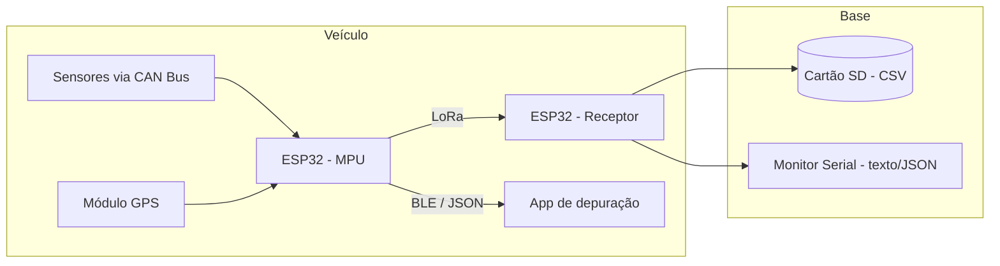
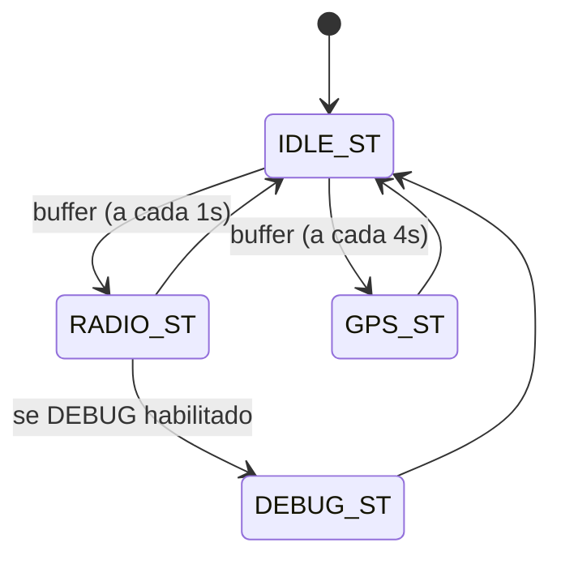

# MangueBaja MPU-25


Sistema de telemetria do veículo Baja SAE da equipe **Mangue Baja (UFPE)**, composto por um Módulo de Processamento (**MPU**) transmissor embarcado no veículo e um módulo **receptor** em terra, ligados por rádio LoRa.

## Visão geral

O projeto utiliza um ESP32 como Módulo de Processamento principal (MPU) no veículo. Ele é responsável por:

* Coletar dados de diversos sensores através de uma rede CAN (IMU, RPM, velocidade, temperaturas, tensão, etc.).
* Obter informações de geolocalização de um módulo GPS.
* Transmitir um pacote de dados consolidado via rádio LoRa para a base.
* Fornecer uma interface de depuração em tempo real via Bluetooth Low Energy (BLE), consultável por um app móvel.

O código do **receptor**, que também roda em um ESP32, recebe os pacotes via LoRa, exibe os dados no monitor serial (texto e JSON) e os registra em um cartão SD para análise posterior.

## Arquitetura



## Estrutura do projeto

```
MangueBaja_MPU-25/
├── include/                # Arquivos de cabeçalho globais
│   ├── can_defs.h          # IDs e structs da rede CAN
│   ├── hard_defs.h         # Pinagem do transmissor (MPU)
│   ├── hard_defs_rec.h     # Pinagem do receptor
│   ├── MPU_defs.h          # Máquina de estados e definições do MPU
│   └── packets.h           # Structs dos pacotes de dados (LoRa e BLE)
├── lib/                    # Bibliotecas customizadas do projeto
│   ├── BLE/                # Comunicação Bluetooth Low Energy
│   ├── CAN/                # Comunicação via CAN
│   ├── LORA/                # Comunicação via LoRa
│   └── StateMachine/        # Máquina de estados do MPU
├── src/
│   └── main.cpp             # Ponto de entrada do MPU transmissor
├── receiver.cpp              # Código-fonte do módulo receptor
├── platformio.ini            # Configuração do PlatformIO e dependências
├── .gitignore
└── README.md
```

## Funcionalidades

### Transmissor (MPU)

* **Gerenciamento por máquina de estados**: buffer circular (`CircularBuffer`) + `Ticker` agendam as leituras de GPS (a cada 4 s) e a montagem/envio do pacote de rádio (a cada 1 s), rodando em tarefas FreeRTOS dedicadas por core.
* **Comunicação CAN**: escuta a rede CAN e atualiza o pacote de telemetria a partir de mensagens de:
    * Acelerômetro e giroscópio (IMU)
    * RPM do motor
    * Velocidade
    * Temperaturas (motor e CVT)
    * Tensão/SOC da bateria
    * Status de outros módulos (SCU, TCU, MMI)
* **Comunicação LoRa**: envia a struct `radio_packet_t` para a estação base a cada ciclo de rádio.
* **Coleta de dados GPS**: usa `TinyGPSPlus` para extrair latitude, longitude e número de satélites, enviando-os também pela CAN (`LAT_ID`/`LNG_ID`).
* **Depuração via BLE**: servidor BLE que, ao receber o comando `"MB"`, responde com um JSON contendo o status atual de LoRa, acelerômetro, temperaturas, tensão, velocidade, modem/MQTT/SD e estado do servo.

### Receptor

* **Recepção LoRa**: recebe pacotes `radio_packet_t` transmitidos pelo veículo.
* **Armazenamento em SD**: grava os dados recebidos em um arquivo `.csv` (um novo arquivo por inicialização, numerado automaticamente).
* **Saída serial**: exibe os dados recebidos tanto em texto simples quanto em JSON (`ArduinoJson`).

## Máquina de estados (MPU)



* `RADIO_ST`: monta o `radio_packet_t` com os últimos dados recebidos pela CAN e o envia por LoRa.
* `GPS_ST`: processa os bytes disponíveis do módulo GPS e publica latitude/longitude na rede CAN quando válidos.
* `DEBUG_ST`: imprime latitude, longitude, hora, data e satélites no serial (habilitado via `#define DEBUG` em `StateMachine.cpp`).

## Protocolo CAN

IDs definidos em `include/can_defs.h`:

| ID    | Nome             | Tamanho | Descrição                                   |
|-------|------------------|---------|----------------------------------------------|
| 0x001 | `SYNC_ID`        | —       | Sincronização do barramento                   |
| 0x100 | `THROTTLE_ID`    | 1 byte  | Estado do acelerador (mid/run/choke)          |
| 0x101 | `FLAGS_ID`       | 1 byte  | Flags de status (bateria, CVT, motor, etc.)   |
| 0x200 | `IMU_ACC_ID`     | 6 bytes | Acelerômetro (X, Y, Z)                        |
| 0x201 | `IMU_DPS_ID`     | 6 bytes | Giroscópio (X, Y, Z)                          |
| 0x205 | `ANGLE_ID`       | 4 bytes | Ângulo                                        |
| 0x300 | `SPEED_ID`       | 2 bytes | Velocidade                                    |
| 0x302 | `SOC_ID`         | 1 byte  | Estado de carga da bateria                    |
| 0x304 | `RPM_ID`         | 2 bytes | Rotação do motor                              |
| 0x305 | `SOT_ID`         | 1 byte  | —                                              |
| 0x400 | `TEMPERATURE_ID` | 1 byte  | Temperatura do motor                          |
| 0x401 | `CVT_ID`         | 1 byte  | Temperatura da CVT                            |
| 0x500 | `FUEL_ID`        | 2 bytes | Nível de combustível                          |
| 0x502 | `VOLTAGE_ID`     | 4 bytes | Tensão                                        |
| 0x505 | `CURRENT_ID`     | 4 bytes | Corrente                                      |
| 0x600 | `LAT_ID`         | 8 bytes | Latitude (enviada pelo MPU após leitura GPS)  |
| 0x700 | `LNG_ID`         | 8 bytes | Longitude (enviada pelo MPU após leitura GPS) |
| 0x306 | `MMI_ID`         | 1 byte  | Módulo MMI (accel_begin)                      |
| 0x307 | `TCU_ID`         | 1 byte  | Módulo TCU (estado do servo)                  |
| 0x308 | `SCU_ID`         | 1 byte  | Módulo SCU (modem, MQTT, SD — bitfield)       |
| 0x309 | `MPU_ID`         | 1 byte  | Requisição do MPU aos demais módulos          |

## Estrutura dos pacotes de dados

Definidos em `include/packets.h`.

**`radio_packet_t`** — telemetria enviada via LoRa:

| Campo         | Tipo       | Descrição                          |
|---------------|------------|-------------------------------------|
| `imu_acc`     | `imu_acc_t`| Aceleração X/Y/Z                    |
| `imu_dps`     | `imu_dps_t`| Velocidade angular X/Y/Z             |
| `rpm`         | `uint16_t` | RPM do motor                        |
| `speed`       | `uint16_t` | Velocidade do veículo                |
| `temperature` | `uint8_t`  | Temperatura do motor                 |
| `flags`       | `uint8_t`  | Bitfield de status (ver comentário no header) |
| `SOC`         | `uint8_t`  | Estado de carga da bateria            |
| `cvt`         | `uint8_t`  | Temperatura da CVT                    |
| `volt`        | `float`    | Tensão                                |
| `latitude`    | `double`   | Latitude GPS                          |
| `longitude`   | `double`   | Longitude GPS                         |
| `timestamp`   | `uint32_t` | Timestamp (`millis()`)                |
| `sat`         | `uint8_t`  | Número de satélites GPS               |

**`bluetooth`** — status dos subsistemas, enviado via BLE em JSON:

| Campo                     | Descrição                              |
|---------------------------|------------------------------------------|
| `lora_init`               | Resultado da inicialização do LoRa       |
| `internet_modem`          | Status do modem de internet (SCU)        |
| `mqtt_client_connection`  | Status da conexão MQTT (SCU)             |
| `sd_start` / `check_sd`   | Status de inicialização/checagem do SD (SCU) |
| `accel_begin`             | Status do acelerômetro (MMI)             |
| `termistor`                | Temperatura do motor (TCU)                |
| `cvt_temperature`          | Temperatura da CVT (TCU)                  |
| `measure_volt`             | Tensão medida (TCU)                       |
| `speed_pulse_counter`      | Contador de pulsos de velocidade (TCU)    |
| `servo_state`              | Estado do servo (CHOKE/MID/RUN/ERRO)      |

## Hardware e pinagem

**Transmissor — `include/hard_defs.h`**

| Periférico | Pino / Config          |
|------------|-------------------------|
| LoRa M0    | GPIO18                 |
| LoRa M1    | GPIO5                  |
| LoRa AUX   | GPIO4                  |
| LoRa RX    | GPIO17 (Serial2 RX)    |
| LoRa TX    | GPIO16 (Serial2 TX)    |
| CAN TX     | GPIO15                 |
| CAN RX     | GPIO13                 |
| GPS RX     | GPIO23 (Serial1)       |
| GPS TX     | GPIO19 (Serial1)       |
| SD CS      | GPIO5                  |
| SPI MISO   | GPIO19                 |
| SPI MOSI   | GPIO23                 |
| SPI SCK    | GPIO18                 |

> Alguns pinos aparecem reaproveitados entre periféricos (ex.: SD/SPI e LoRa/GPS). Confirme o esquemático antes de portar a pinagem para uma nova placa.

**Receptor — `include/hard_defs_rec.h`**

| Periférico | Pino / Config          |
|------------|-------------------------|
| LoRa M0    | GPIO12                 |
| LoRa M1    | GPIO14                 |
| LoRa AUX   | GPIO13                 |
| LoRa RX    | GPIO17 (Serial2 RX)    |
| LoRa TX    | GPIO16 (Serial2 TX)    |
| SD CS      | GPIO5                  |
| SPI MISO   | GPIO19                 |
| SPI MOSI   | GPIO23                 |
| SPI SCK    | GPIO18                 |

## Dependências

Gerenciadas pelo `platformio.ini`:

| Biblioteca      | Fonte                                                                 | Uso                              |
|------------------|------------------------------------------------------------------------|-----------------------------------|
| EBYTE            | github.com/KrisKasprzak/EBYTE                                          | Controle do módulo LoRa (E32/EBYTE)|
| CANmsg           | github.com/joaogabrielsantosD/CANmsg                                   | Comunicação via barramento CAN    |
| CircularBuffer   | rlogiacco/CircularBuffer `^1.3.3`                                       | Buffer circular da máquina de estados |
| TinyGPSPlus-ESP32| tinyu-zhao/TinyGPSPlus-ESP32 `^0.0.2`                                   | Parsing de dados GPS              |
| ArduinoJson      | bblanchon/ArduinoJson `^7.2.0`                                          | Serialização JSON (BLE e receptor)|

## Como compilar e gravar

Este projeto usa [PlatformIO](https://platformio.org/).

```bash
# Instalar dependências e compilar o firmware do MPU (transmissor)
pio run

# Gravar no ESP32 conectado
pio run --target upload

# Abrir o monitor serial
pio device monitor
```

Para compilar o **receptor** (`receiver.cpp`), aponte o `platformio.ini` para esse arquivo como `src` ou crie um ambiente (`env`) dedicado a ele, já que os dois firmwares (MPU e receptor) não são compilados juntos.

## Equipe

Projeto mantido pela equipe **Mangue Baja**, da Universidade Federal de Pernambuco (UFPE), competidora do Baja SAE Brasil.
